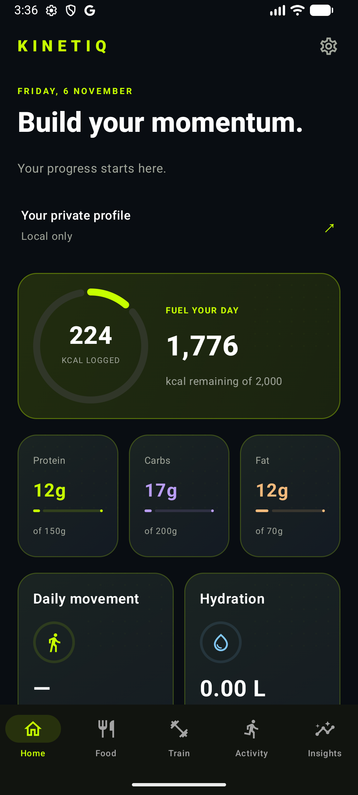
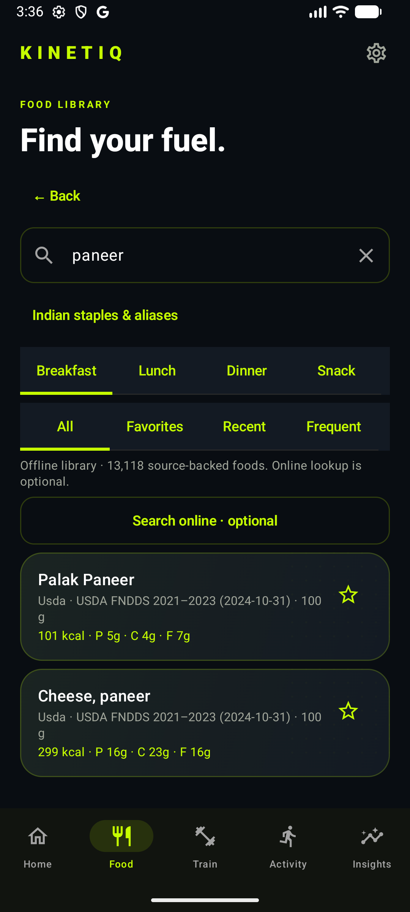
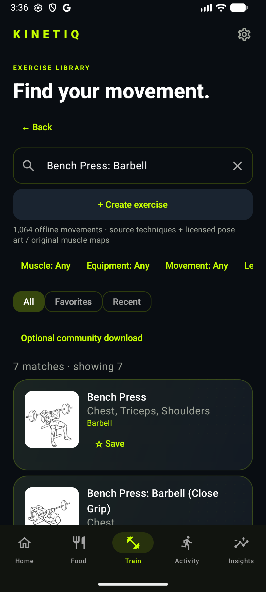
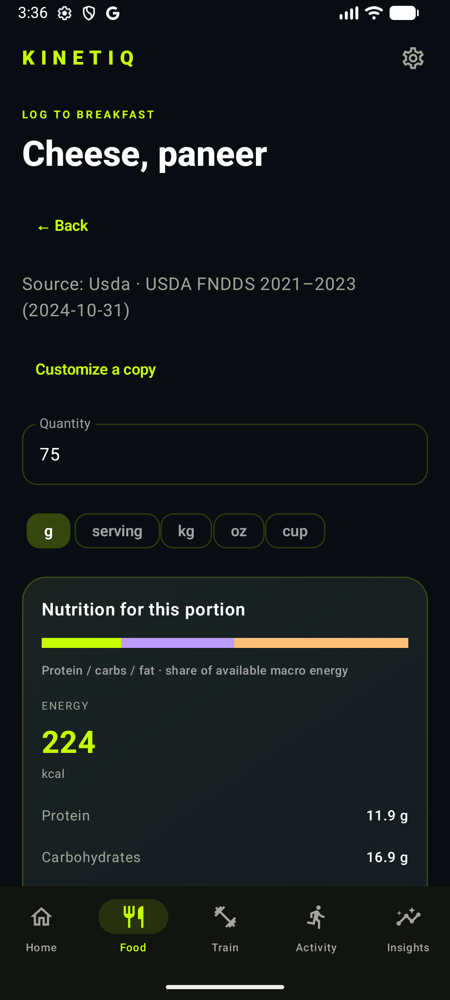
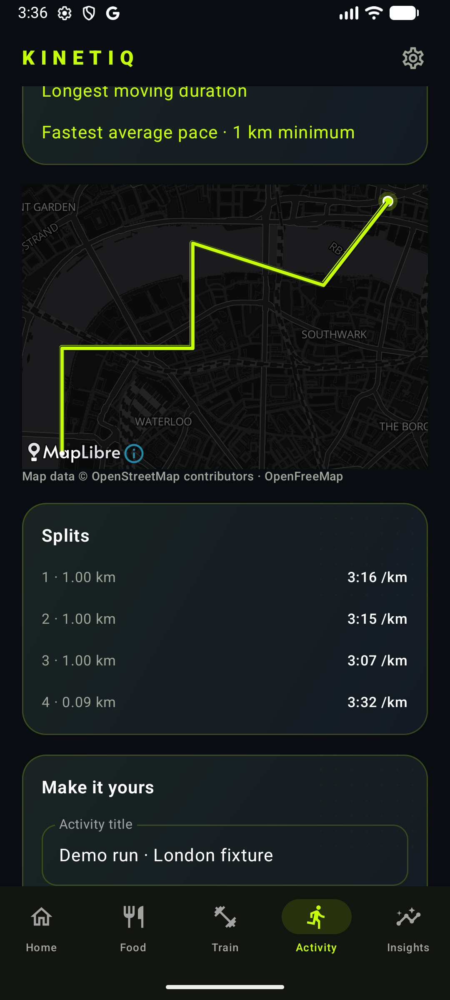
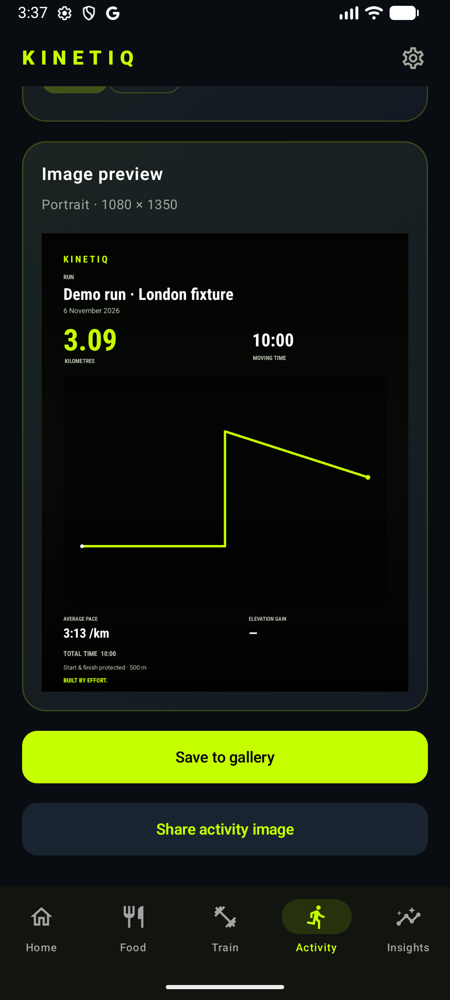

# KINETIQ

**Workouts, food, outdoor activities and music — in one pocket.**

I wanted a fitness app that brought those things together, so I started building KINETIQ for myself. The first version came out of an overnight building session: AI coding agents handled much of the implementation while I focused on the idea, decisions, testing and iteration. The offline libraries, account separation, route-sharing fixes and updater came through subsequent development. This is still my personal Beta, not a finished commercial fitness product.

**[Download the Beta APK →](https://github.com/vaishnavg121/kinetiq-releases/releases)**

<table>
<tr><td></td><td></td><td></td></tr>
<tr><td></td><td></td><td></td></tr>
</table>

These are real emulator screens using isolated local QA records. The London route is simulated; the workout set is a draft example. No personal fitness records or simulated Spotify playback are presented as real activity.

- **Food that works offline:** 13,118 source-backed USDA entries, local search and aliases, food-specific portions, custom nutrition, recipes and repeat meals. Online lookups are optional.
- **Training:** 1,064 catalog records, offline visuals, muscle/equipment/movement filters, favorites, custom exercises, sets, timers, supersets, templates and PR history.
- **Outdoor sessions:** GPS recording, pause/resume, saved routes and GPX. Route drawing works independently of map tiles. Share PNG/JPEG in Story, portrait or square formats, with explicit endpoint privacy controls.
- **Your profile:** local Guest records, Google sign-in and optional Firestore sync with separate account stores.
- **Make it yours:** Lime, Blue, Purple, Graphite and AMOLED; dark cards with restrained halftone and spring feedback. Spotify App Remote/Web API integration is optional.

Built with **Kotlin, Jetpack Compose, Room, SQLite FTS, coroutines, Firebase, MapLibre and Spotify App Remote**.

## Install once, then update inside the app

Open the [release page](https://github.com/vaishnavg121/kinetiq-releases/releases) on your phone and install **KINETIQ.apk**. Allow installation from your browser when Android asks. Existing `com.vanta` installations update in place; do not uninstall first.

If you already use the separate `com.vanta.debug` installation, use **KINETIQ-debug.apk** to keep that installation's data. Production and debug are separate apps; switching packages does not automatically transfer local records.

In KINETIQ, choose **Settings → About → Beta → Check for Updates**, then download and initiate Android's installer. The app verifies version, package, size, SHA-256 and signing certificate before installation. Android still asks for installation consent.

## The honest limitations

Physical GPS accuracy/OEM background behavior, real Health Connect sensors and a second real Firebase account/device still need phone testing. Spotify login could not be completed on the review emulator, so live playback is unverified. Food providers can return timeouts/rate limits/503s; local search remains available.

Exercise visuals include **268 exact source pose illustrations and 796 labelled muscle-target maps**. Muscle maps are not starting/ending technique demonstrations. Regional Indian dishes and dedicated yoga/Pilates sequences are incomplete; custom foods, recipes and exercises cover personal additions. Source technique content has not been medically reviewed.

## Credits, code and iteration

USDA FoodData Central food data is public domain/CC0. Everkinetic / Greg Priday exercise data and vectors are CC BY-SA 4.0. Additional free-exercise-db **metadata** is Unlicensed/public-domain; its uncertain photographs are excluded. Original muscle maps are KINETIQ code. [Dataset provenance, licenses and coverage](docs/DATA_SOURCES.md).

AI agents contributed substantially to the code, fixes and tests. I review the result and keep iterating from actual bugs and phone feedback. The existing source repository is currently private because older history contains authenticated screenshots and device-derived fixtures. This public distribution repository hosts reviewed screenshots, notes and signed releases; history has not been rewritten or force-pushed.
